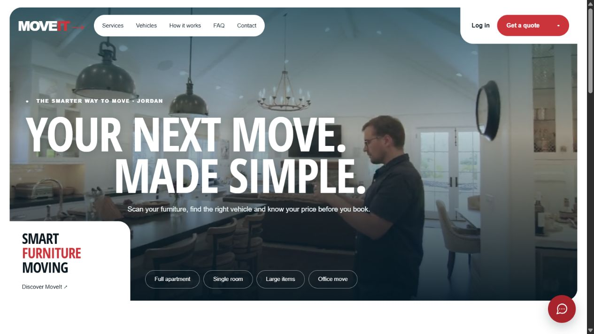
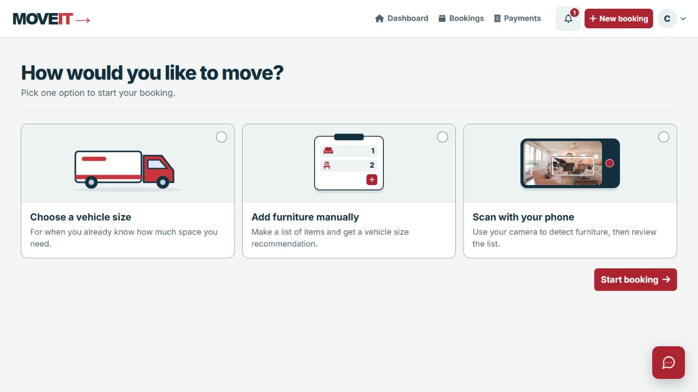
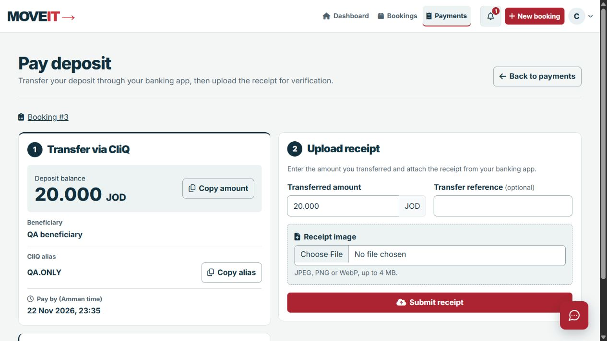
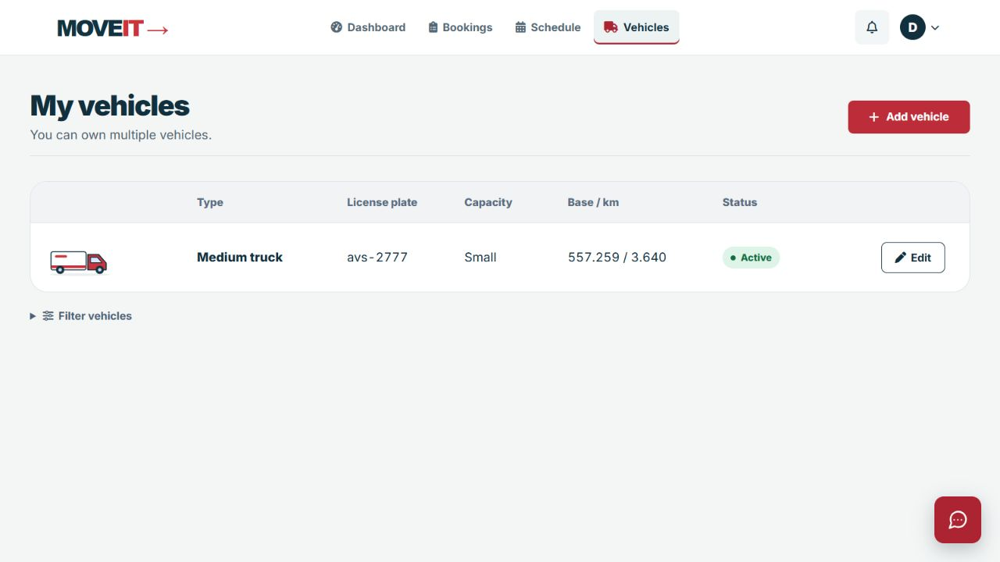
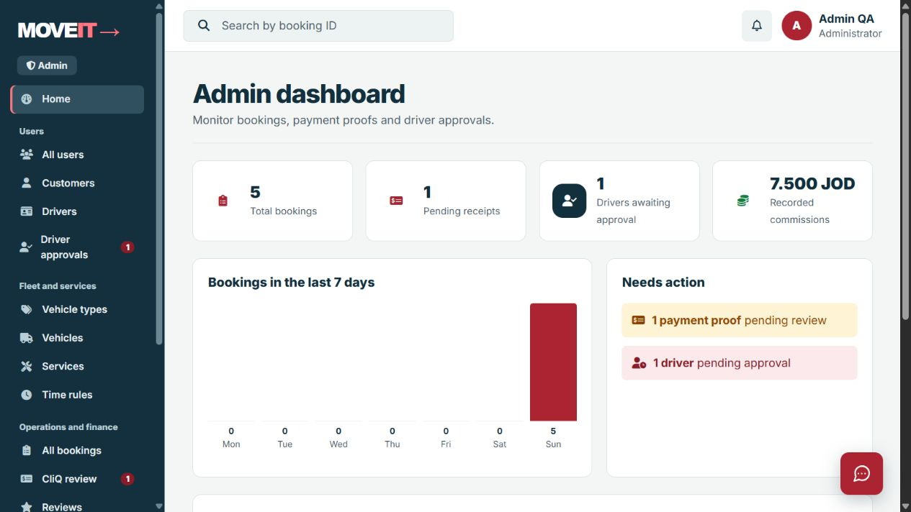

# MoveIt

MoveIt is a moving-service platform for customers, drivers, and administrators. Customers build a booking, review a quote, and submit a CliQ deposit receipt. Once an administrator verifies the full deposit, MoveIt looks for an available driver and shares the assignment after the driver accepts.



Screenshots in this guide use demo data.

## Features

### Customer booking



- Start with a vehicle size, a manual inventory, or a phone scan. A confirmed inventory helps MoveIt recommend a vehicle size.
- Pin pickup and destination on the map, record floor and elevator access, and choose a single pickup appointment in Amman time.
- Review the road distance, total, and deposit. Add services such as loading workers, packing, boxes, or assembly. Quantity changes save and refresh the quote automatically.
- Track the move and get updates about receipts, driver assignment, and booking status.

### CliQ deposits and receipts



Customers transfer the deposit through their banking app and upload a receipt with the amount and an optional reference. Payment history tracks the review status and provides a receipt preview. MoveIt starts looking for a driver after an administrator verifies the full deposit. The assigned driver and vehicle appear after the driver accepts.

### Driver workspace



Drivers apply for approval before accessing their workspace. Approved drivers can manage vehicles and availability, respond to offers, and track assigned moves. Fleet entries show vehicle capacity, operating status, and base and per-kilometer rates.

### Administration



Administrators review driver applications and receipts, search bookings, and monitor outstanding actions. They also manage the vehicle and service catalog, time-based pricing rules, and deposit and commission settings.

### AI furniture scanning

Customers pair their phone with a booking using a temporary QR code. The scanner detects supported furniture categories and sends suggestions to the draft. Customers can correct item types and quantities before confirming the inventory. See [Optional furniture scanner](#optional-furniture-scanner) for setup.

## Technology

The web application uses Laravel 12, Blade, Bootstrap, and Vite. Leaflet displays maps, OSRM calculates road distances for quotes, and SweetAlert2 handles confirmations and receipt previews. The optional scanner runs YOLO in a separate FastAPI service.

## Local setup

### Prerequisites

- PHP 8.2 or later with PDO SQLite, or PDO MySQL for a MySQL database
- Composer 2
- Node.js 22.12 or later and npm
- Python 3.12 only if you are running the furniture scanner

### Install and start

Run these commands from the repository root. The PowerShell commands preserve an existing environment file and SQLite database.

```powershell
composer install
if (!(Test-Path .env)) { Copy-Item .env.example .env }
if (!(Test-Path database/database.sqlite)) { New-Item -ItemType File database/database.sqlite }
npm ci
```

For a fresh setup, set the following values in `.env`. The example file already defaults to SQLite. For MySQL, create a local database and configure the `DB_*` settings before running the migrations.

```dotenv
APP_NAME=MoveIt
APP_URL=http://127.0.0.1:8000
DB_CONNECTION=sqlite
```

Generate the application key once for a new environment. Keep the existing key if the application is already configured.

```powershell
php artisan key:generate
php artisan migrate
composer dev
```

Open [http://127.0.0.1:8000](http://127.0.0.1:8000). The `composer dev` script runs Laravel, Vite, the queue listener, and the scheduler. For a standalone Laravel server, build the frontend with `npm run build` and start it with `php artisan serve`.

### Demo data

On a local database, run:

```powershell
php artisan db:seed --class=MoveItDemoSeeder
```

The seeder adds a sample catalog, bookings, payment receipts, and role-based accounts such as `customer@moveit.test`, `driver@moveit.test`, and `admin@moveit.test`. It prints the generated password when it creates or updates demo credentials. Use the sign-in page to enter the appropriate workspace.

## Configuration

Set local configuration in `.env`. Keep environment files, real banking details, and account credentials out of source control.

| Setting | Purpose |
| --- | --- |
| `OSRM_BASE_URL` | OSRM endpoint used to calculate the road distance for a quote |
| `BOOKING_DEPOSIT_PERCENT` | Share of the booking total due as a deposit |
| `BOOKING_COMMISSION_PERCENT` | Platform commission rate |
| `BOOKING_DEPOSIT_MINUTES` | Time allowed to submit the deposit |
| `CLIK_BENEFICIARY_NAME`, `CLIK_ID` | Beneficiary name and CliQ alias shown at checkout |
| `SCAN_BASE_URL` | HTTPS address for the scanner experience |
| `OLLAMA_URL`, `OLLAMA_MODEL`, `OLLAMA_TIMEOUT` | Optional chatbot configuration |

Saved admin settings take precedence over the booking and CliQ defaults in `.env`. Customers make the CliQ transfer in their banking app and upload a receipt for manual review. Booking appointments and payment deadlines are displayed in Amman time. When checkout settings are incomplete, customers can still get a quote if route pricing is available.

The scheduler checks for expired deposit holds and retries driver matching. If you start Laravel separately, run `php artisan schedule:work` in another terminal for local testing. For deployment, follow the [Laravel scheduler setup](https://laravel.com/docs/12.x/scheduling#running-the-scheduler).

## Optional furniture scanner

The Laravel app supports manual inventory entry without the scanner. To run detection locally, place the `yolo26s.pt` weights in `ai-service/`. Model weights are excluded from Git.

```powershell
cd ai-service
py -3.12 -m venv .venv
.\.venv\Scripts\python.exe -m pip install -r requirements.txt
.\.venv\Scripts\python.exe -m uvicorn main:app --host 127.0.0.1 --port 8001
```

The committed requirements pin CUDA 12.8 builds of PyTorch and TorchVision. On a CPU-only machine, use matching CPU builds in a local copy of the requirements. [PyTorch installation guide](https://pytorch.org/get-started/locally/)

- Check the service at [http://127.0.0.1:8001](http://127.0.0.1:8001). Its response confirms FastAPI is running. The detector loads the weights when a valid scan session connects.
- The scanner calls Laravel at `http://127.0.0.1:8000/api/scanner` by default. Set `SCANNER_API_URL` in the scanner process environment if Laravel is running elsewhere.
- The included `Caddyfile` demonstrates local routing on port `8080`. It forwards `/ws/*` to FastAPI on `8001` and other requests to Laravel on `8000`. For phone pairing, serve that same routing through an HTTPS address reachable from the phone and set `SCAN_BASE_URL` to that address.

## Project structure

| Path | Responsibility |
| --- | --- |
| `app/Http/Controllers/`, `app/Services/` | Booking, payments, matching, and application workflows |
| `routes/` | Web and API routes, plus scheduled commands |
| `resources/views/` | Blade views organized by feature |
| `public/landing/css/`, `public/js/` | Shared UI styles and browser interactions |
| `database/` | Migrations, factories, and local seed data |
| `ai-service/` | Scanner API, detection, tracking, and inventory catalog |
| `tests/` | Application tests |

Workspace pages use `layouts.dashboard` or `layouts.app`. Public information pages use `layouts.info`, and sign-in and registration use `layouts.auth`. Reuse named routes and existing Blade components when adding screens.

## Development checks

```powershell
php artisan test
npm run build
php artisan route:list
php artisan schedule:list
```

The test suite uses an in-memory SQLite database. If a configuration change is still showing old values locally, run `php artisan config:clear`.
